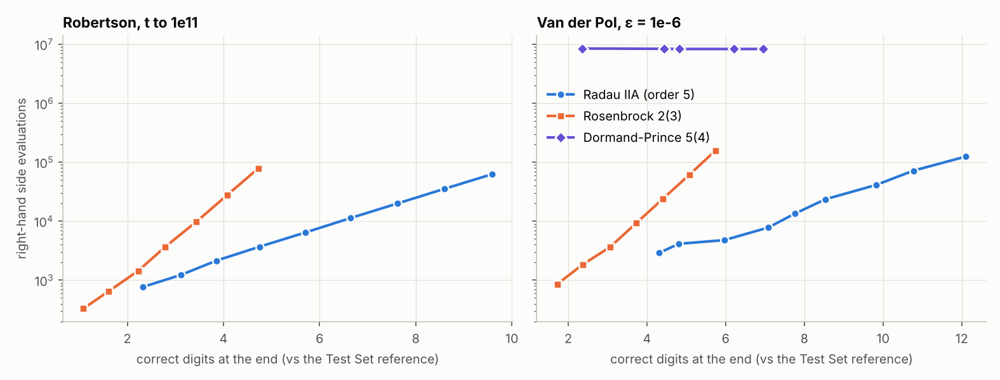
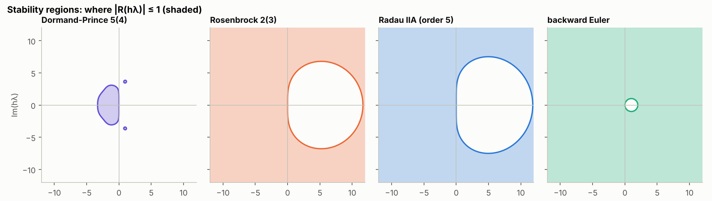
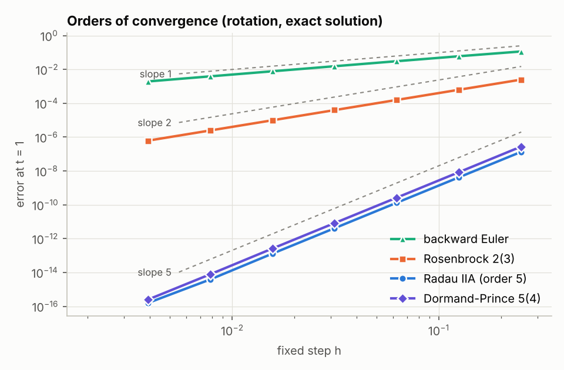
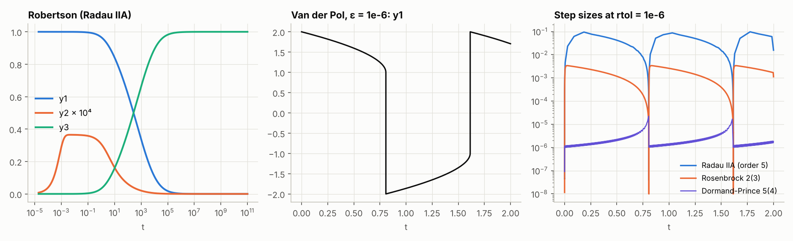

# stiff-ode-solvers

Four ODE solvers written from scratch in Julia, using only the standard library:

- an explicit Dormand-Prince 5(4) pair, as the non-stiff reference;
- the L-stable Rosenbrock 2(3) pair behind MATLAB's `ode23s`;
- a three-stage Radau IIA method of order 5 with simplified Newton iteration and Hairer and Wanner's error estimate;
- fixed-step backward Euler.

They are tested on two stiff problems from the Bari Test Set for IVP Solvers, against its published reference solutions.



The right-hand panel shows what stiffness means. On Van der Pol with ε = 10⁻⁶, the explicit method takes about 1.16 million steps at every tolerance from 10⁻³ to 10⁻⁷, because stability limits the step, not accuracy. Radau IIA reaches 7 correct digits in 862 steps and 12 digits in 15,606.

## Results

| Claim | Evidence | Grade |
|---|---|---|
| Each method has its designed order | Fixed steps on a problem with an exact solution: observed orders 5.00 (Dormand-Prince), 2.00 (Rosenbrock), 5.00 (Radau IIA) and 0.99 (backward Euler) | proven by test |
| Stability functions are exactly as designed | Computed by running one step on y' = zy, then compared with closed forms to 10⁻¹²: Dormand-Prince's degree-6 polynomial, Radau IIA's (2,3) Padé approximant, 1/(1 − z). Rosenbrock, Radau and backward Euler are A- and L-stable | proven by test |
| The Radau error estimate is RADAU5's | The embedded weights are derived in code from the order-3 conditions. They reproduce the constants of Hairer's RADAU5, γ₀⁻¹ = 3.6378342527 and its error coefficients, to 10⁻¹² | proven by test |
| Robertson to t = 10¹¹ | Radau IIA at rtol 10⁻⁸: every component within 2.3 × 10⁻⁷ (relative) of the Test Set reference, in 1,352 steps. The invariant y₁ + y₂ + y₃ = 1 holds to 2 × 10⁻¹⁵ | proven by test (bound 10⁻⁶) |
| Van der Pol, ε = 10⁻⁶ | Radau IIA at rtol 10⁻⁸: error 2.6 × 10⁻⁹ against the reference at t = 2. Rosenbrock at 10⁻⁶: 3.5 × 10⁻⁵ | proven by test (bounds 10⁻⁷, 10⁻³) |
| Explicit methods fail on stiff problems | At rtol 10⁻⁶, Dormand-Prince needs 1,160,504 steps (8.3 million evaluations) against Radau's 862 | measured |

## The methods

**Dormand-Prince 5(4)** (`DOPRI5`) takes seven stages per step. The fifth-order solution is used, and the difference from the embedded fourth-order one estimates the error. Its stability region (below) is bounded, reaching only to about −3.3 on the real axis. So a stiff eigenvalue λ forces h ≲ 3.3/|λ| however smooth the solution is.

**Rosenbrock 2(3)** (`Rosenbrock23`) is Shampine and Reichelt's ode23s pair. It is linearly implicit: each step solves three linear systems with the single matrix W = I − h d J, d = 1/(2 + √2), and needs no Newton iteration. The second-order solution is L-stable, and the error estimate is of third order. It suits loose tolerances, but needs many steps for many digits.

**Radau IIA, order 5** (`RadauIIA5`) is the three-stage collocation method at the Radau points. The stage increments z solve z = h (A ⊗ I) F(y₀ + z), by simplified Newton iteration with the matrix I − h (A ⊗ J).

- The method is stiffly accurate, so the new solution is the last stage.
- The error estimate comes from an embedded order-3 method with an explicit term γ₀ h f(y₀), filtered through (I − hγ₀J)⁻¹ so that very stiff components cannot inflate it.
- The embedded weights are not typed in. They are derived from the order conditions, and a test checks them against RADAU5's constants.
- Step-size control follows Hairer and Wanner: an error⁻¹ᐟ⁴ rule, with a safety factor that grows when Newton converged quickly.
- If Newton diverges, the step is halved and retried.

**Backward Euler** takes fixed steps, with Newton iteration. It is order 1 and L-stable, the simplest stiff solver, and is included for comparison.



An A-stable method is stable in the whole left half-plane. L-stability adds R(z) → 0 as z → −∞, so infinitely stiff components are damped in one step instead of oscillating. Radau IIA and backward Euler are stable even in much of the right half-plane, where the exact solution grows.



## The test problems



**Robertson** (1966) models three chemical species with rate constants spanning nine orders of magnitude (0.04, 10⁴, 3 × 10⁷). It is integrated over sixteen decades, to t = 10¹¹:

- y₂ peaks at 3.7 × 10⁻⁵ and decays.
- The solution is smooth throughout, but the stiff eigenvalue is −2 × 10³ by t = 1 and −10⁴ at the end. An explicit method could not take steps much longer than 10⁻³, so reaching t = 10¹¹ would take some 10¹⁴ steps.
- y₁ + y₂ + y₃ = 1 is a linear invariant. Runge-Kutta and Rosenbrock methods preserve such invariants, so it holds to rounding error.

**Van der Pol** in the Test Set's scaled form, y₁' = y₂, y₂' = ((1 − y₁²) y₂ − y₁)/ε with ε = 10⁻⁶:

- slow phases alternate with near-instant jumps;
- the adaptive implicit methods take steps up to 10⁻¹ on the slow branches, and steps four orders of magnitude smaller through the jumps;
- the explicit method stays near 10⁻⁶ throughout (right panel).

Both reference solutions come from the Test Set, computed by RADAU at a tolerance of 1.1 × 10⁻¹⁸:

- Robertson at t = 10¹¹: (2.083340149701255 × 10⁻⁸, 8.333360770334713 × 10⁻¹⁴, 0.9999999791665050);
- Van der Pol at t = 2: (1.706167732170483, −0.8928097010247975).

The work-precision diagram measures "correct digits" as −log₁₀ of the largest relative error at the end point.

## Usage

```julia
using StiffSolvers
prob = ODEProblem((y, t) -> [y[2], ((1 - y[1]^2) * y[2] - y[1]) / 1e-6], [2.0, 0.0], (0.0, 2.0))
sol = solve(prob, RadauIIA5(); rtol=1e-8, atol=1e-8)   # Jacobian by finite differences
sol.u[end], sol.stats.naccept
solve(prob, Rosenbrock23(); dt=1e-4)                    # fixed steps
stability_function(RadauIIA5(), -1.0 + 2im)
```

```bash
julia --project=. -e 'using Pkg; Pkg.test()'    # 46 tests, about 15 s after compilation
julia --project=. bench/work_precision.jl        # data for the figures, about 2 minutes
python3 scripts/figures.py                       # needs matplotlib
```

Supplying `jac=(y, t) -> J` to `ODEProblem` avoids the finite-difference Jacobian. The timings in `docs/data/work_precision.csv` are from Julia 1.13 on a 2-vCPU Xeon at 2.1 GHz. Every Radau IIA run takes under 0.1 s.

## Layout

```text
src/StiffSolvers.jl   problem and solution types, the adaptive driver, Jacobians, stability functions
src/dopri5.jl         Dormand-Prince 5(4)
src/rosenbrock23.jl   Rosenbrock 2(3), ode23s
src/radau.jl          Radau IIA order 5: Newton iteration and error estimate
src/backward_euler.jl backward Euler
src/problems.jl       Robertson, Van der Pol, Prothero-Robinson, rotation; Test Set references
test/runtests.jl      orders, stability functions, reference solutions, invariants
bench/                work-precision data and traces
scripts/figures.py    the figures
```

## Limits

- **Small systems only.** Radau IIA factorises the full 3n × 3n Newton matrix, while RADAU5 splits it into one real and one complex n × n system. That is fine for small n, but for large systems it is slower than it needs to be.
- **Dense Jacobians.** They are dense, and either analytic or forward differences. There is no sparsity and no Jacobian reuse across steps.
- **No dense output, events, or DAE mass matrices.** Rosenbrock and Radau methods extend to DAEs naturally, but this code does not.
- **Fixed order.** There is no variable-order BDF method (the approach of LSODE and CVODE). Comparing with one would show where multistep methods win.

## References

- E. Hairer, G. Wanner, *Solving Ordinary Differential Equations II: Stiff and Differential-Algebraic Problems*, 2nd ed., Springer (1996).
- E. Hairer, S. P. Nørsett, G. Wanner, *Solving Ordinary Differential Equations I: Nonstiff Problems*, 2nd ed., Springer (1993).
- J. R. Dormand, P. J. Prince, *A family of embedded Runge-Kutta formulae*, J. Comput. Appl. Math. 6, 19 (1980).
- L. F. Shampine, M. W. Reichelt, *The MATLAB ODE Suite*, SIAM J. Sci. Comput. 18, 1 (1997).
- H. H. Robertson, *The solution of a set of reaction rate equations*, in *Numerical Analysis: An Introduction*, Academic Press (1966).
- F. Mazzia, C. Magherini, *Test Set for IVP Solvers*, release 2.4, University of Bari (2008), archimede.uniba.it/~testset.

## Licence

Copyright (c) 2026 Ankit Pawar. All Rights Reserved.

This repository is public so that the work can be read and evaluated, but it is not open source. Using, copying, modifying, redistributing or commercially exploiting any part of it requires prior written permission. This does not affect what applicable law allows without permission, or viewing and forking the repository on GitHub under GitHub's Terms of Service. The full terms are in [LICENSE](LICENSE).

Commits up to and including `441ec1c` were released under the MIT License, and copies obtained under those terms keep them.

For licensing or collaboration, email ankitpawar0007x@gmail.com or visit [ankitinorbit.com](https://ankitinorbit.com).
